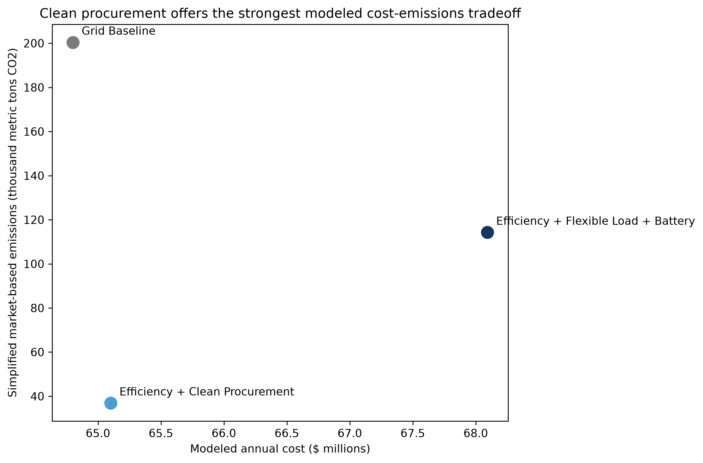
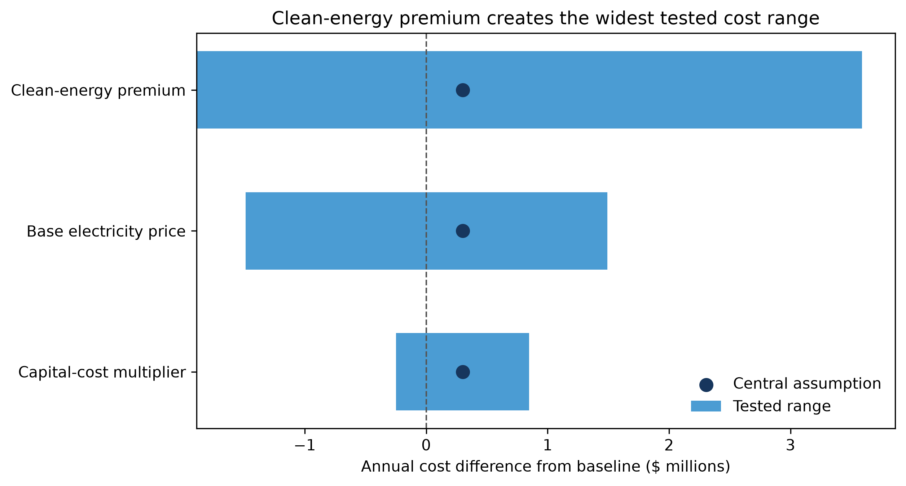

# Data Center Energy and Community Impact Strategy

This project evaluates energy, cost, emissions, peak-demand, and climate-planning considerations for a hypothetical 100 MW data center in Loudoun County, Virginia. It was developed as a screening-level analysis to demonstrate how public data and simplified quantitative modeling can support early-stage energy and sustainability decisions.

## Project question

How could a large data center reduce its electricity-related emissions while managing annual cost, peak demand, and climate-related planning considerations?

## Scenarios evaluated

1. **Grid Baseline:** Continued operation using the unmodified facility load profile and regional grid electricity.

2. **Efficiency + Clean Procurement:** An 8% efficiency improvement combined with renewable procurement covering 80% of remaining annual electricity use.

3. **Efficiency + Flexible Load + Battery:** A 5% efficiency improvement, flexible-load shifting, 40% renewable procurement, and a simplified 20 MW/80 MWh battery peak-shaving strategy.

## Headline results

| Scenario | Annual electricity use | Peak demand | Annual cost | Simplified market-based emissions |
|---|---:|---:|---:|---:|
| Grid Baseline | 744,600 MWh | 90.2 MW | $64.8 million | 200,424 metric tons CO2 |
| Efficiency + Clean Procurement | 685,032 MWh | 83.0 MW | $65.1 million | 36,878 metric tons CO2 |
| Efficiency + Flexible Load + Battery | 707,477 MWh | 83.8 MW | $68.1 million | 114,259 metric tons CO2 |

Under the central assumptions, Efficiency + Clean Procurement produces the largest modeled emissions reduction while increasing annual cost by approximately $0.3 million, or 0.5%, relative to the baseline. It also remains less expensive than the battery package across all illustrative sensitivity cases tested.



## Recommendation

Advance the efficiency and clean-procurement strategy to more detailed evaluation. The screening results suggest that it could substantially reduce reported Scope 2 emissions while remaining close to baseline annual cost.

Before implementation, the client would need to validate the assumed efficiency savings, utility tariff, procurement options, capital costs, and emissions-accounting treatment.

## Analysis workflow

The analysis is organized into four notebooks:

1. `01_public_context.ipynb` assembles EPA eGRID, Census ACS, and FEMA National Risk Index context.
2. `02_facility_load.ipynb` creates a reproducible synthetic 8,760-hour load profile.
3. `03_scenario_model.ipynb` evaluates energy use, peak demand, cost, and emissions across three scenarios.
4. `04_sensitivity.ipynb` tests how electricity prices, clean-energy premiums, and capital costs affect the recommendation.

## Data sources

- [EPA Emissions & Generation Resource Integrated Database (eGRID)](https://www.epa.gov/egrid/detailed-data)
- [U.S. Census Bureau American Community Survey](https://data.census.gov/)
- [FEMA National Risk Index](https://hazards.fema.gov/nri/)

The electricity emissions factor, demographic indicators, and hazard indicators are based on public data. The facility load profile, cost assumptions, technology assumptions, and project scenarios are illustrative.

Raw source files are excluded from this repository. The first notebook documents the expected files and processing steps.

## Key modeling assumptions

- 100 MW hypothetical design capacity
- 85 MW average facility demand
- $70/MWh base electricity price
- $12/kW-month demand charge
- $6/MWh clean-energy procurement premium
- 7% discount rate and 15-year capital-recovery period
- Simplified annual matching for market-based emissions
- One idealized battery cycle per month with 90% round-trip efficiency

## Sensitivity analysis

The sensitivity analysis varies:

- Base electricity price from $50 to $100/MWh
- Clean-energy premium from $2 to $12/MWh
- Capital cost from 75% to 125% of the central estimate

Clean-energy procurement remains less expensive than the battery package in every tested case. Its cost relative to the baseline depends most strongly on the clean-energy premium.



## Important limitations

This is a screening analysis, not an engineering design, utility tariff study, power-market forecast, or investment-grade estimate.

The analysis does not evaluate:

- Available utility or transmission capacity
- Parcel-level flood and stormwater exposure
- Hourly renewable-energy matching
- Residual-mix emissions factors
- Battery state-of-charge optimization
- Outage performance or critical-load resilience
- Community attitudes or project acceptance

A real project would require utility coordination, parcel-level climate-risk analysis, engineering review, vendor pricing, procurement evaluation, and direct community engagement.

## Running the notebooks

Create and activate a Python environment, then install the required packages:

```bash
pip install -r requirements.txt